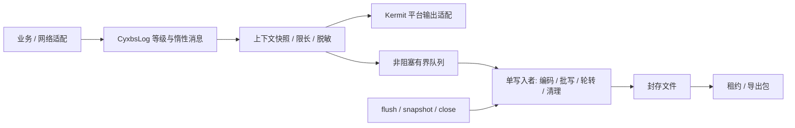

# 掌上重邮 KMP 日志框架调研

调研日期：2026-10-13。范围：GitHub 候选、关键源码行为、掌邮接入边界及自建设计。仅调研与文档；没有修改业务代码、添加依赖或执行性能基准。文中参数是候选起点，性能结论只描述源码机制，不声称已在掌邮实测。

## 1. 选型结论

建议长期采用 **自有 CyxbsLog 薄门面 + Kermit 平台输出 + 自有轻量文件引擎**。短期如果只要跨端控制台和有限滚动文件，**Kermit + kermit-io 可以直接作为接入基线**。无需从零实现全部输出，也不建议一开始就维护 C++/Rust 日志引擎。

这里有一个关键事实：Kermit 不只有控制台组件。已经核验其 2.2.0 tag 和 Maven metadata 中的 kermit-io 2.2.0，内含 RollingFileLogWriter。它解决了单线程写入、大小轮转和文件数量保留，但满队列会阻塞调用线程，没有公开的可等待 flush、close 或导出快照接口。这些限制影响掌邮主线程和用户反馈附日志的长期需求。

## 2. GitHub 候选对比

| 框架 | 可以复用什么 | 文件与性能方面的限制 | 对掌邮的建议 |
|---|---|---|---|
| [Touchlab Kermit](https://github.com/touchlab/Kermit) | KMP 日志入口、平台 LogWriter、惰性消息；kermit-io 提供滚动文件 | IO 组件只提供 Android/JVM/Native；队列满会阻塞；逐条 flush；生命周期/导出需补 | 首选复用基础；快速接入或平台输出后端 |
| [AAkira Napier](https://github.com/AAkira/Napier) | 简单的 KMP 入口和 Antilog 输出扩展 | 核验源码中的 lambda 重载先求值再过滤；没有核验到与上述完整文件引擎等价的内建能力 | 适合轻量门面，本次不优于 Kermit |
| [Biotelligent KmLog](https://github.com/Biotelligent/KmLog) | README 声明覆盖 Android/iOS/JVM/JS/Wasm，提供惰性消息和缓存等级判断 | README 的线程安全和性能声明未做完整源码/实机证明；2.0 改为 com.diamondedge.logging 包名 | 保留候选；不能据宣传认定解决持久化问题 |
| [Tencent Mars / Xlog](https://github.com/Tencent/mars) | C++、mmap 缓冲、压缩/加密、恢复、日期/大小分文件 | async 路径仍可能在调用线程压缩；需原生桥接与解码工具链 | 高负载、恢复需求明确后做 PoC |
| [s1rius EZLog](https://github.com/s1rius/ezlog) | Rust 后台编码压缩加密、mmap、轮转与解码 CLI | 队列满会丢控制消息；公开 flush 无完成回执；Rust log facade flush 是空方法 | 可作为后续原生后端候选，需补语义 |
| [美团点评 Logan](https://github.com/Meituan-Dianping/Logan) | C 核心、Android/iOS 包装、gzip/AES、采集解析体系 | 达到当天文件上限后停止写入；两端背压不同；非官方 KMP 依赖 | 已采用 Logan 体系时更适合，新组件不默认选它 |

Kermit、Napier、KmLog 主体为 Apache-2.0；Mars 主体为 MIT，但第三方依赖另有许可证；EZLog 核心 MIT OR Apache-2.0；Logan MIT。发布时应保留实际引入代码和依赖的许可声明。仓库未归档或有 push，不等价于所有平台适配经过验证，也不等价于核心持续高频维护。

[HackWebRTC/kmp-xlog](https://github.com/HackWebRTC/kmp-xlog) 是搜索到的桥接候选。本次没有形成足够的发行、平台覆盖和源码可靠性证据，不把它作为省去 JNI/cinterop 维护成本的选型前提。

## 3. Kermit 文件组件：能接入，但要了解实际保证

固定参考版本 2.2.0，SHA `774cc1ca81c73b7f14ef2b49b0dcd6dda213d1c6`：

- [RollingFileLogWriter](https://github.com/touchlab/Kermit/blob/774cc1ca81c73b7f14ef2b49b0dcd6dda213d1c6/kermit-io/src/commonMain/kotlin/co/touchlab/kermit/io/RollingFileLogWriter.kt)：单独线程上下文与常驻消费协程独占文件；Channel 容量 64；时间戳、文本格式化、throwable.stackTraceToString、Buffer 构造发生在调用线程。每条记录写入后 sink.flush。
- [Native ChannelSend](https://github.com/touchlab/Kermit/blob/774cc1ca81c73b7f14ef2b49b0dcd6dda213d1c6/kermit-io/src/nativeMain/kotlin/co/touchlab/kermit/io/ChannelSend.kt)：实际采用 trySendBlocking。队列满后 Native 也会阻塞。JVM 路径对已被 interrupt 的线程另有非阻塞尝试和丢弃行为。
- [RollingFileLogWriterConfig](https://github.com/touchlab/Kermit/blob/774cc1ca81c73b7f14ef2b49b0dcd6dda213d1c6/kermit-io/src/commonMain/kotlin/co/touchlab/kermit/io/RollingFileLogWriterConfig.kt)：默认单文件 10 MiB，最多 5 个。检查已有大小后轮转，单条超大记录仍可能突破阈值，不能视为严格总容量配额。
- [IO 模块构建](https://github.com/touchlab/Kermit/blob/774cc1ca81c73b7f14ef2b49b0dcd6dda213d1c6/kermit-io/build.gradle.kts)：Android/JVM/Native，没有 JS/Wasm 目标。其文件系统是 kotlinx.io，不是 Okio。
- 写入 IOException 会被处理，尝试恢复文件访问；但不能承诺错误期间记录不丢失。iOS 锁屏后台文件保护是具体需要处理的场景。
- 没有公开的 flush/close/snapshot；内部 scope/channel 为私有。继承或外围包装不能自然获得“屏障前事件全部写入”和资源回收协议。

接入方式：commonMain 依赖 Kermit 门面；noWebMain 引入 kermit-io；平台初始化传入私有目录和策略。浏览器使用单独 writer。需要验证发布变体和依赖解析，不把整个 IO 模块放进所有目标都依赖的 commonMain。

项目 [依赖目录](</Users/generals/AndroidProject/CyxbsMobile/gradle/libs.versions.toml#L106>) 为 Kotlin 2.4.10、coroutines 1.11.0、datetime 0.8.0、Okio 3.18.1；Kermit 2.2.0 [构建依赖](https://github.com/touchlab/Kermit/blob/774cc1ca81c73b7f14ef2b49b0dcd6dda213d1c6/gradle/libs.versions.toml) 为 Kotlin 2.3.21、coroutines 1.11.0、datetime 0.7.0、kotlinx.io 0.8.0。不存在明显“项目 Kotlin 太旧”的证据，但 datetime 升级解析、Native klib 和各目标兼容性仍需最小工程验证，本轮没有编译。

Napier 参考 master `50835e2…` 的核验行为：lambda 重载先执行 message()，然后进入过滤；rawLog 中 any 输出启用后，会对所有 Antilog 执行 performLog。需要逐输出目的地过滤时不能只依赖全局判断。此结论限于所读版本，最终依赖必须固定完整 tag/SHA 后再验证，不能推广到全部发行版本。

## 4. 原生优秀实现值得借鉴的机制

### 4.1 Xlog：成熟缓冲设计，但 async 不等于调用线程无重工作

阅读 [appender.cc](https://github.com/Tencent/mars/blob/master/mars/xlog/src/appender.cc)、[log_base_buffer.cc](https://github.com/Tencent/mars/blob/master/mars/xlog/src/log_base_buffer.cc)、[log_zlib_buffer.cc](https://github.com/Tencent/mars/blob/master/mars/xlog/src/log_zlib_buffer.cc)。

async 路径先在调用线程格式化，再在 mutex_buffer_async_ 下调用 log_buff_->Write。Write 先 Compress 后 CryptAsyncLog；zlib 使用 deflate(..., Z_SYNC_FLUSH)，初始化使用 Z_BEST_COMPRESSION。因此调用线程可能承担压缩、加密和映射缓冲写入。

缓冲约 150 KiB，达到约 1/3 或 Fatal 唤醒后台，接近满时有额外处理。mmap 失败退回堆缓冲，启动时恢复有效映射数据；后台批量写文件，结合日期和大小分文件，按 mtime/保留时间删除旧日志。保留时间不是全目录容量硬配额。

Flush 主要通知后台；FlushSync 会写出缓冲，但所读路径没有足够证据承诺 fsync。mmap 恢复也不是逐条事务提交或断电不丢失保证。

### 4.2 EZLog：后台压缩与控制命令可靠性要一起看

固定 SHA `a5fc5cf3a5a00e735a519ebe68c4e127339e2006`：

- [lib.rs:193](https://github.com/s1rius/ezlog/blob/a5fc5cf3a5a00e735a519ebe68c4e127339e2006/ezlog-core/src/lib.rs#L193)：调用线程先执行 layers，再 try_send。容量 200，队列满时报告错误并丢弃；flush 也走这条路径。初始化前缓存锁可等待 200 ms。
- [logger.rs](https://github.com/s1rius/ezlog/blob/a5fc5cf3a5a00e735a519ebe68c4e127339e2006/ezlog-core/src/logger.rs)：worker 执行编码、压缩、加密、append。caller 仍承担记录构造、FFI 复制和 layers 等成本。
- [appender.rs](https://github.com/s1rius/ezlog/blob/a5fc5cf3a5a00e735a519ebe68c4e127339e2006/ezlog-core/src/appender.rs)：先更新 header 中的写入位置再写 payload，恢复不是崩溃原子性保证。mmap 路径调用 memmap2 flush，fallback 调用 BufWriter.flush；没有显式 File.sync_all，不据此声称完整记录断电持久化。
- 公开 flush 只是发消息；[Rust log facade flush:388](https://github.com/s1rius/ezlog/blob/a5fc5cf3a5a00e735a519ebe68c4e127339e2006/ezlog-core/src/init.rs#L388) 是空方法。
- [config.rs](https://github.com/s1rius/ezlog/blob/a5fc5cf3a5a00e735a519ebe68c4e127339e2006/ezlog-core/src/config.rs)：默认文件 150000 字节、保留 7 日、轮转间隔 1 日；压缩和加密默认 NONE。年龄清理不限制总目录容量，预分配文件也要计入空间预算。

核心 Cargo 版本 0.2.0，有 Android JNI、iOS C/Pod 与 [ezlogcli](https://github.com/s1rius/ezlog/tree/master/ezlogcli)。但需要自行维护 Rust 交叉编译、多 ABI、iOS 模拟器/真机、链接、发布和解码版本。动态版本 0.2+ 不应直接作为生产固定依赖。核验 head 为 2025-08-26 的 Dependabot 工作流更新，不能从 push 时间推断核心高频迭代。

### 4.3 Logan：当天文件达到上限的行为会影响日志完整性

实际仓库是美团点评 [Meituan-Dianping/Logan](https://github.com/Meituan-Dianping/Logan)。搜索过程中的 didi/Logan 返回 404，不能将美团源码归属为滴滴。

[Android 配置](https://github.com/Meituan-Dianping/Logan/blob/master/Example/Logan-Android/logan/src/main/java/com/dianping/logan/LoganConfig.java) 默认队列 500、保留 7 日、文件上限 10 MiB、磁盘余量 50 MiB；满队列可能静默丢。worker 做 native 压缩，但 caller 仍可能锁等待。[iOS Logan.m](https://github.com/Meituan-Dianping/Logan/blob/master/Logan/iOS/Logan.m) 使用串行 dispatch queue，没有核验到 Android 等价的显式 500 条队列上限；flush 无完成回执，两端空间检查也不一致。

[Clogan](https://github.com/Meituan-Dianping/Logan/blob/master/Logan/Clogan/clogan_core.c) 使用 gzip/AES、mmap 和有限结构恢复，最终 fwrite + fflush，未见 fsync。**当天文件达到上限后拒绝写入，不是自动按大小创建后续文件。** Podspec 的 1.2.10 为所读源码中的版本，不表示本次确认它是最新发行。2025 年存在 Android 16 KiB 页相关适配修补，但不能称作高频维护。

这三者都不是掌邮所有平台可直接使用的统一 commonMain 依赖。只有持续高负载、压缩加密、崩溃缓冲恢复等需求明确，并且团队接受双端原生构建和解码维护时，才值得接入。

## 5. 掌邮现有实现的具体问题

| 源码 | 已核验行为 | 对设计的影响 |
|---|---|---|
| [common Log](</Users/generals/AndroidProject/CyxbsMobile/cyxbs-components/utils/src/commonMain/kotlin/com/cyxbs/components/utils/extensions/Log.kt>) | 只有 log(msg)、log(tag,msg)、logg(Any?) | 增加等级、异常、惰性消息和上下文 |
| [Android actual](</Users/generals/AndroidProject/CyxbsMobile/cyxbs-components/utils/src/androidMain/kotlin/com/cyxbs/components/utils/extensions/Log.android.kt>) | 每条构造 Exception 获取位置，再 Log.d | 热路径避免默认堆栈采集 |
| [iOS actual](</Users/generals/AndroidProject/CyxbsMobile/cyxbs-components/utils/src/iosMain/kotlin/com/cyxbs/components/utils/extensions/Log.ios.kt>) | NSLog | 补跨平台文件落盘 |
| [LogLocal](</Users/generals/AndroidProject/CyxbsMobile/cyxbs-components/utils/src/androidMain/kotlin/com/cyxbs/components/utils/utils/LogLocal.kt>) | 每条 Rx 调度到 IO；共享 helper 无明确单写入者保护；throwable 未使用 | 长寿命单消费者，统一生命周期 |
| [LogLocalHelper](</Users/generals/AndroidProject/CyxbsMobile/cyxbs-components/utils/src/androidMain/kotlin/com/cyxbs/components/utils/utils/LogLocalHelper.kt>) | 初始化全量 readLines；1/multiple 整数除法在默认 multiple=2 时导致清空；运行中无持续轮转；逐条加密 | 滚动文件替代全量重写；学号派生密钥需废弃 |
| [LogUtils](</Users/generals/AndroidProject/CyxbsMobile/cyxbs-components/utils/src/androidMain/kotlin/com/cyxbs/components/utils/utils/LogUtils.kt#L23>) | Release 保留 ERROR | 控制台与文件的过滤分别定义 |
| [ApiGenerator:257](</Users/generals/AndroidProject/CyxbsMobile/cyxbs-components/utils/src/androidMain/kotlin/com/cyxbs/components/utils/network/ApiGenerator.kt#L257>) | HttpLoggingInterceptor BODY 同时送控制台与文件，此处无 release gate | 生产采集必须限范围、限长、脱敏 |
| [ScheduleDiagnosticLog](</Users/generals/AndroidProject/CyxbsMobile/cyxbs-pages/schedule/src/commonMain/kotlin/com/cyxbs/pages/schedule/data/remote/ScheduleDiagnosticLog.kt>) | 日程标题和分类名进入部分调试日志 | 业务字段也需要允许记录名单 |

[现有 KMP 插件](</Users/generals/AndroidProject/CyxbsMobile/build-logic/plugin/kmp/src/main/kotlin/kmp.base.gradle.kts>) 已有 noWebMain，供 Android/iOS/desktop 共用；webMain 供浏览器 JS/Wasm 共用。建议未来新增低依赖的 cyxbs-components/logging：commonMain 放事件、门面、策略与协议；noWebMain 放文件引擎；平台层提供目录、平台输出、生命周期和存储同步能力；webMain 采用有界内存环，确有需求再加 IndexedDB/下载。

底层模块不依赖账号、网络或 utils 大模块。版本、设备和匿名会话信息由应用注入，避免循环依赖。[Okio 官方平台说明](https://lysine.dev/okio/multiplatform/) 的 JS 文件系统要求 Node，不能用于掌邮浏览器目标。

## 6. 自有文件引擎应该包含什么

### 6.1 事件协议与调用热路径

事件包含 schemaVersion、采集时间、level、tag/category、sessionId、requestId/traceId、message、受控 fields 和 exception。worker 赋文件内单调序号；墙上时钟不能保证跨线程排序。

先判断输出目的地是否启用，再执行消息 lambda。不记录的 Debug 不拼字符串、不序列化、不采堆栈。通过过滤的 lambda 在调用线程求值，避免 worker 延后执行时读到已经变化的业务状态；结构化字段做快照，重编码与堆栈文本格式化尽可能在 worker。

Kermit LogWriter 接口只有 severity/message/tag/throwable。结构化事件直接进入自有文件引擎，同时映射给 Kermit 输出，不要先转字符串再解析回事件。只需文本时可直接 Kermit + 自定义 LogWriter。

默认不逐条启动协程、打开文件或定位调用行号。入队负载限长不能保证业务 lambda 自行构造巨型 String 时的峰值，要有调用约定。

### 6.2 有界内存和过载

普通 log() 用非挂起、非阻塞入队，避免 runBlocking。同时限制条数和估算负载字节数，不能只用 Channel(1024) 认为内存已控制。

首版可满队列丢新普通事件，统计 droppedByLevel、queueHighWatermark、oversized、writeFailures。需要更高等级保障时再预留有限容量或关键事件内存环，同时定义合并顺序。有限队列不能保证无限过载时 ERROR 永不丢失。

空间恢复后由 worker 直接写丢弃摘要，不能调用日志 API 形成递归。IO 错误通过独立健康状态暴露；业务线程不因文件失败崩溃。定义初始化前、重复初始化及关闭后调用行为。

### 6.3 单写入者、批量写与刷出语义

长寿命 worker 独占文件、编码 buffer、轮转和清理，避免多写入者锁竞争。按字节或时间形成批次；周期 flush 必须有 timer/select，不能仅在下一条日志到来时检查，否则静默期间尾批长期留在内存。

区分已接收、已写出用户态缓冲、已同步存储三种状态。第三种需要平台真实同步原语与结果，不支持则报告 unsupported。不能仅凭方法叫 flush 就承诺断电不丢。

已阅读 [Okio FileHandle](https://github.com/square/okio/blob/master/okio/src/commonMain/kotlin/okio/FileHandle.kt) 与 [JvmFileHandle](https://github.com/square/okio/blob/master/okio/src/jvmMain/kotlin/okio/JvmFileHandle.kt)：JVM handle protectedFlush 调用 randomAccessFile.fd.sync()。实际语义取决于打开的 sink/handle；不能把所有 BufferedSink.flush 都视为 fsync，也不能认为所有 flush 都只是普通缓冲操作。Native 后端另行核验。

### 6.4 文件配额、轮转和故障恢复

- 按 UTF-8 编码字节控制单文件，结合日期/session 轮转。写前检查当前大小 + 下一条大小，单条限长并标记截断。
- 文件名唯一可排序，应对时间回拨、重启和多进程。默认各进程独立文件，单 actor 的线程安全不等于跨进程安全。
- 总字节、文件数、保留时间共同限制；只删除本引擎认可的封存文件。启动/轮转/必要的周期检查配额，不 readLines 整个文件重写。
- active 文件和导出租约文件不能被删；空间不足或新文件失败时报告降级，避免先破坏旧文件再发现无法创建新文件。所有 IO 失败有重试退避与丢弃统计。
- 首版 JSONL 易解析，异常和换行转义为单事件一行；中断后的尾部不完整记录可忽略/截断。它不解决断电、随机损坏和全部历史恢复。以后有明确块恢复需求再加长度、版本、校验、提交标记与兼容解码器。

### 6.5 flush、close、snapshot 是协议

flush 用可等待屏障：覆盖屏障入队前成功接收的事件，worker 完成后回执，返回成功/失败/超时。控制消息不能使用满队列会丢弃的 trySend；可挂起 send 进同一有序 mailbox。不能用队列暂时为空推断已写入完成。

close 停止接收，处理已收事件，刷出关闭并释放资源，要求幂等。snapshot 由 worker 刷出并封存当前文件、切新文件、给文件列表建立租约；独立后台任务打包，成功/失败后释放。避免导出与轮转/清理竞争。

导出临时包另设大小、并发和过期限制；租约不能成为无限增长的配额漏洞。应用后台尽力限时 flush，但 iOS 挂起、Android 强杀、native 崩溃不能依赖协程一定跑完。普通日志组件不替代原生崩溃采集器。

### 6.6 隐私与平台策略

Android 用私有目录并排除备份；iOS 可选 Application Support 排除备份，或明确接受 Caches 的系统清理语义。锁屏后台要评估文件保护等级，不能为日志一律关闭保护。

网络默认记 method、归一化 path、状态、耗时、requestId 和受控错误码，不默认记完整 BODY、token、cookie、学号、电话。业务标题也要约束。[Ktor sanitizeHeader](https://ktor.io/docs/client-logging.html) 只处理指定 header，不会自动处理 body/query。采集适配器负责业务字段允许名单，输出前脱敏，导出再次检查，避免重复网络拦截。

加密不替代内容最小化。有明确需求再采用平台密钥设施和成熟加密库、随机密钥、版本化解码协议；不使用学号派生密钥，不自创加密模式。

## 7. 候选参数和接入验证

以下是压测起点，不是已验证的最优参数，也不是框架默认值。

| 参数 | 候选值 | 验证重点 |
|---|---|---|
| 队列 | 1024 条，另设约 2 MiB 负载预算 | 两个上限均生效，对象开销另计 |
| 单条编码负载 | 16 KiB，超长截断 | 保留足够诊断内容 |
| batch | 32–64 KiB 或 0.5–1 秒 | 吞吐、安静时刷出、丢失窗口 |
| 单文件 | 2–5 MiB | 轮转和导出耗时 |
| 日志总量 | 20–30 MiB | active/封存/预留；导出临时包另有预算 |
| 保留时长 | 3–7 天 | 受容量同时限制，不保证覆盖全部天数 |
| 格式 | JSONL，导出时按需压缩 | 首版便于人工检查和兼容解析 |

至少测 Android 低端真机与 iOS 真机：常态、突发并发、过滤 lambda、超大消息、throwable、轮转、磁盘满、权限失败、iOS 锁屏后台、强杀、导出清理竞争。记录调用线程 p50/p95/p99、分配量、峰值内存、worker 吞吐、CPU/能耗、队列峰值、丢弃、flush 耗时、启动恢复和导出可解析率。按掌邮实际日志量和主线程预算设验收值，不引用厂商 benchmark 替代。

建议后续顺序：

1. 固定 Kermit 版本做最小平台编译和控制台接入验证，确认 Android/iOS/desktop/Web 变体与依赖解析。
2. 若只要滚动文本，用 kermit-io 做试点并测满队列调用延迟；若要可靠反馈导出，实施自有文件 worker、配额与生命周期协议。
3. 接入旧 log/LogUtils/LogLocal 兼容桥和网络适配器，防止新旧重复输出，再迁移业务分类。
4. 真实日志量显示瓶颈后，才以 Xlog/EZLog 替换文件后端，保持业务门面稳定。

本轮交付为调研，不表示这些步骤已经实施。
